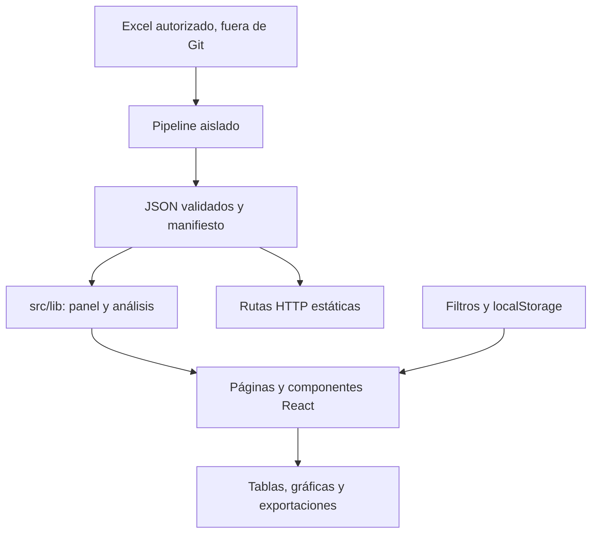

# Arquitectura implementada

## Vista general

Aplicación Next.js con App Router. El proceso de extracción se ejecuta antes de publicar una edición; el navegador consume los JSON procesados y calcula las vistas interactivas. No existe un servicio de IA, base de datos remota ni API de escritura.

## Responsabilidades y dependencias

| Capa | Archivos de entrada | Responsabilidad |
| --- | --- | --- |
| Fuente y contrato | `scripts/lib/data-contract.ts`, `panel-schema.ts` | Unidades, hojas, códigos y estructura válida. |
| Generación | `scripts/run-data-pipeline.ts` | Secuencia de extracción, aislamiento y sustitución de la edición. |
| Lectura del panel | `src/lib/company-panel.ts`, `company-detail.ts` | Convertir filas/columnas en objetos y obtener empresa/periodo. |
| Reglas matemáticas | `src/lib/metric-math.ts` | Sumas completas y tasas de respuestas emparejadas. |
| Comparaciones | `selection-comparison.ts`, `benchmark-comparison.ts` | Agregación, grupo fijo, pares y percentiles. |
| Análisis | `signal-analysis.ts`, `decision-intelligence.ts`, `consulting-agenda.ts`, `data-quality.ts` | Cambios, composición, tendencias y revisión de calidad. |
| Interpretación | `executive-reading.ts`, `copilot-engine.ts`, `scenario.ts` | Lecturas deterministas, preguntas admitidas y escenarios. |
| Interfaz | `src/app`, `src/components` | Presentar resultados, capturar selección y ejecutar acciones. |

Las páginas importan componentes y funciones de `src/lib`. Los componentes no leen el Excel. Las funciones estadísticas no dependen de React. Los extractores comparten `metric-math.ts` con la aplicación para evitar fórmulas incompatibles.

Los archivos `*-data.ts` adaptan agregados procesados usados por ciertas gráficas del último mercado. No deben confundirse con cálculos filtrados: antes de reutilizarlos hay que verificar el alcance que anuncia la página.

## Flujo de una selección

1. `src/app/layout.tsx` instala `FilterProvider` una sola vez.
2. `components/filters/filter-picker.tsx` captura compañía(s) y tiempo.
3. `comparison-selection.ts` valida y normaliza códigos, periodos y meses.
4. El contexto conserva la selección individual y la múltiple por separado. Una consulta múltiple abre `/comparar`.
5. `selection-comparison.ts` obtiene observaciones, calcula el conjunto disponible y fija las compañías comunes cuando hay varios cortes.
6. `components/analysis/comparison-view.tsx` dibuja, exporta CSV y abre el detalle de una celda con compañía y fecha correctas.

La selección cambia resultados calculados, no modifica la fuente. `route-path.ts` normaliza las barras finales para que la navegación coincida en desarrollo y en la exportación estática.

## Persistencia y API

- Los filtros y las hipótesis viven en `localStorage` del navegador.
- `decision-journal.ts` valida los registros de la bitácora y conserva la evidencia del corte original.
- `components/analysis/previous-actions.tsx` mantiene acceso a seguimientos guardados por la edición alojada anterior; no es código descartable.
- `/api/market` y `/api/people-intelligence` son respuestas JSON de lectura con `force-static`. No consultan una base de datos ni autorizan filas por usuario.

## Límites operativos

El acceso privado del alojamiento protege la entrada al sitio. Dentro de la aplicación, los visitantes autorizados reciben los datos incluidos en el cliente. Una separación por organización requeriría autenticación y consultas autorizadas en servidor; no basta un filtro ni un umbral mínimo de muestra.

Las hojas, siete periodos y 40 códigos forman el contrato de esta edición. Admitir una fuente distinta requiere un cambio explícito del contrato, sus pruebas y una extracción completa.
