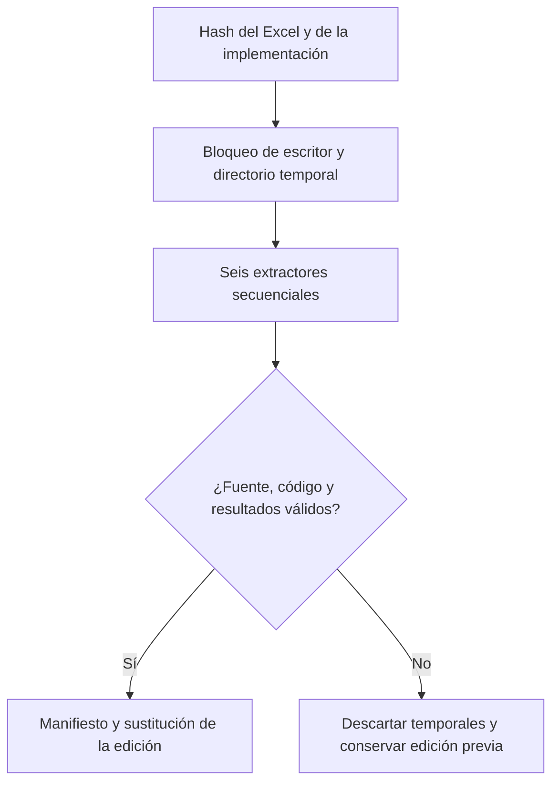

# Pipeline de datos

## Dos procesos distintos

El **pipeline de datos** convierte el Excel en una edición analítica validada. La **CI de software** comprueba que el código, esa edición y la aplicación siguen siendo compatibles. La CI no tiene el Excel privado y no vuelve a extraerlo.

## Ejecutar una actualización

Desde la raíz del repositorio, con Node 24 y `npm ci` completado:

```bash
npm run data:extract -- "/ruta/BASE HISTORICA.xlsx"
npm run verify
```

El comando de extracción acepta opcionalmente un directorio de salida como segundo argumento. Para desarrollo normal no hace falta regenerar nada: los JSON versionados permiten ejecutar la aplicación y sus pruebas.

## Secuencia y garantías



El orquestador es [`run-data-pipeline.ts`](../scripts/run-data-pipeline.ts). Los nombres y el orden están definidos en [`pipeline-contract.ts`](../scripts/lib/pipeline-contract.ts).

| Orden | Extractor | Salida |
| --- | --- | --- |
| 1 | `extract-company-periods.ts` | Siete JSON en `company-periods/`, con columnas y filas por bimestre. |
| 2 | `extract-historical.ts` | `benchmark.json`: serie histórica y agregados de mercado. |
| 3 | `extract-people-intelligence.ts` | `people-intelligence.json`: bajas, composición y compensación. |
| 4 | `extract-workforce-rewards.ts` | `workforce-rewards.json`: demanda de puestos y beneficios. |
| 5 | `extract-extended-intelligence.ts` | `extended-intelligence.json`: dominios complementarios. |
| 6 | `extract-company-detail.ts` | `company-detail.json`: detalle técnico y mensual por compañía/corte. |

Son **12 archivos de datos**, más `pipeline-manifest.json`. Los extractores reciben la misma ruta y escriben en `CATCH_DATA_OUTPUT`, un directorio aislado creado por el orquestador.

## Qué se valida

- Exactamente siete hojas/periodos y `COMPAÑIA 1` a `COMPAÑIA 40`, sin duplicados.
- Tipos, columnas, longitud de filas, conteos y rangos admitidos por el esquema.
- Correspondencia entre los 280 registros del panel y del detalle.
- Conciliación histórica de altas y bajas y tasas de bajas, ausencias e incapacidades.
- Que el Excel y el código no hayan cambiado durante la extracción.
- SHA-256 de cada salida y firma de los archivos de implementación enumerados por el contrato.

El manifiesto usa **schemaVersion 3**. La firma incluye las rutas y contenidos de los extractores, el orquestador, sus contratos y `src/lib/metric-math.ts`. Por eso esos archivos no se mueven durante una limpieza de carpetas: hacerlo exige regenerar desde la fuente. Nunca se actualizan firmas a mano para hacer pasar una verificación.

## Preprocesamiento

Las unidades se declaran por campo. Un `1` no se convierte en `100` por su magnitud. Faltantes, negativos inválidos, porcentajes fuera de rango y denominadores cero se excluyen según el contrato; no se inventan valores. Los rechazos fuera de 0–100 conservan celda y valor original como evidencia de revisión. Las composiciones requieren categorías completas y tolerancia explícita. Los periodos mensuales solo se habilitan cuando el encabezado está confirmado.

El [contrato](data-contract.md) describe la fuente. El [registro de métricas](metric-registry.md) explica cómo se consumen las cantidades válidas.

## Verificación sin Excel

`npm run data:verify` lee el manifiesto, comprueba la firma vigente del código, exige el conjunto exacto de archivos, recalcula sus hashes y valida coherencia entre salidas. Se ejecuta también antes de desarrollo y compilación. Detecta una edición mezclada o modificada a mano; no puede volver a comprobar cada celda del Excel sin disponer del archivo original.

## Fallos y recuperación

| Mensaje o situación | Cómo actuar |
| --- | --- |
| `Extraction code changed since this generation` | Regenerar con el Excel autorizado, revisar el diff de datos y ejecutar `npm run verify`. |
| `Dataset changed outside the complete pipeline` | Investigar el archivo alterado y restaurar una edición completa conocida o regenerarla; no editar el manifiesto. |
| Falta una hoja o cambia una columna | Confirmar que es la fuente correcta. Si el cambio es intencional, actualizar contrato y pruebas. |
| Existe `data/.data-pipeline.lock` | Confirmar primero que no hay un proceso activo. Si es un bloqueo abandonado, retirar solo ese directorio vacío y repetir. |
| Falla un extractor | La edición previa se conserva; corregir la causa y repetir el comando completo. |

Durante la sustitución se conserva un respaldo temporal y se intenta restaurarlo si falla el renombrado. Esto no equivale a una transacción durable ante un corte de energía entre renombrados. Git conserva las ediciones anteriores; los temporales y bloqueos están excluidos.

No ejecutar extractores individuales directamente sobre `data/processed`: dejarían una edición sin manifiesto coherente. No borrar datos procesados como si fueran archivos de compilación; son necesarios para reproducir el proyecto sin el Excel privado.
