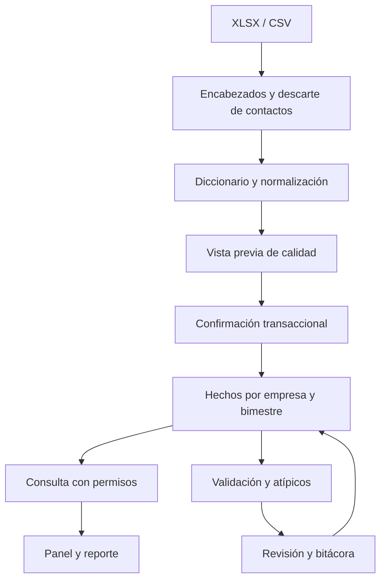
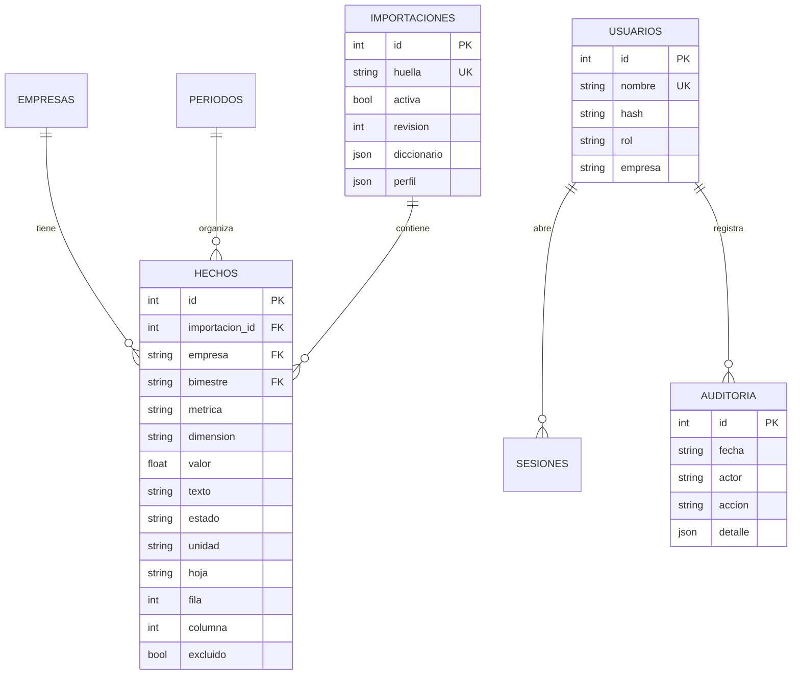

# Arquitectura y modelo de datos

FastAPI sirve API y HTML/JS/CSS del mismo origen. SQLAlchemy gestiona tablas, transacciones, parámetros e índices. SQLite es el almacenamiento local probado. Las tablas usan tipos portables; PostgreSQL requerirá driver, configuración y validación propias.

## Modelo implementado

La relación usuario–auditoría es lógica por nombre de actor, no una FK; también existen actores locales del CLI. La empresa del usuario determina el aislamiento del cliente. El HMAC se aplica en la representación, no sustituye la autorización.

Granularidad de HECHOS: empresa, bimestre, métrica, dimensión y celda de origen. Importación+hoja+fila+columna es único. Encabezados ambiguos se registran sin un valor utilizable para no colapsar dos respuestas bajo una misma métrica. Índice por empresa/bimestre/métrica y por importación.

No se crean tablas ficticias de empleados, cohortes o movimientos individuales: la encuesta no permite poblarlas. Las preguntas sobre puestos, vacantes, fuentes, beneficios y contratos son dimensiones de los hechos de encuesta, no entidades transaccionales inventadas. Si se obtiene un historial individual, se agregan tablas relacionadas con identidades privadas y hechos de entrada/salida.

## Versiones, operaciones y límites

- `migraciones.py` aplica versión inicial 1 idempotente y registra `version_esquema`. Una versión diferente se rechaza; futuros cambios requerirán migraciones explícitas y respaldo, no borrar/recrear la base.
- Se conserva cada importación. Confirmar una nueva desactiva la anterior dentro de la transacción.
- Vistas previas en memoria, no en navegador. No hay upload de archivos a terceros ni dependencias CDN.
- `/api/panel` consulta solo campos del núcleo; `/api/explorar` filtra métrica en SQL. Calidad y exportación necesitan más columnas; son operaciones apropiadas para el tamaño actual, no para millones de empleados.
- El despliegue soportado en esta versión es un proceso local. Escalado distribuido, trabajos en cola y almacenamiento compartido requieren implementación adicional.
